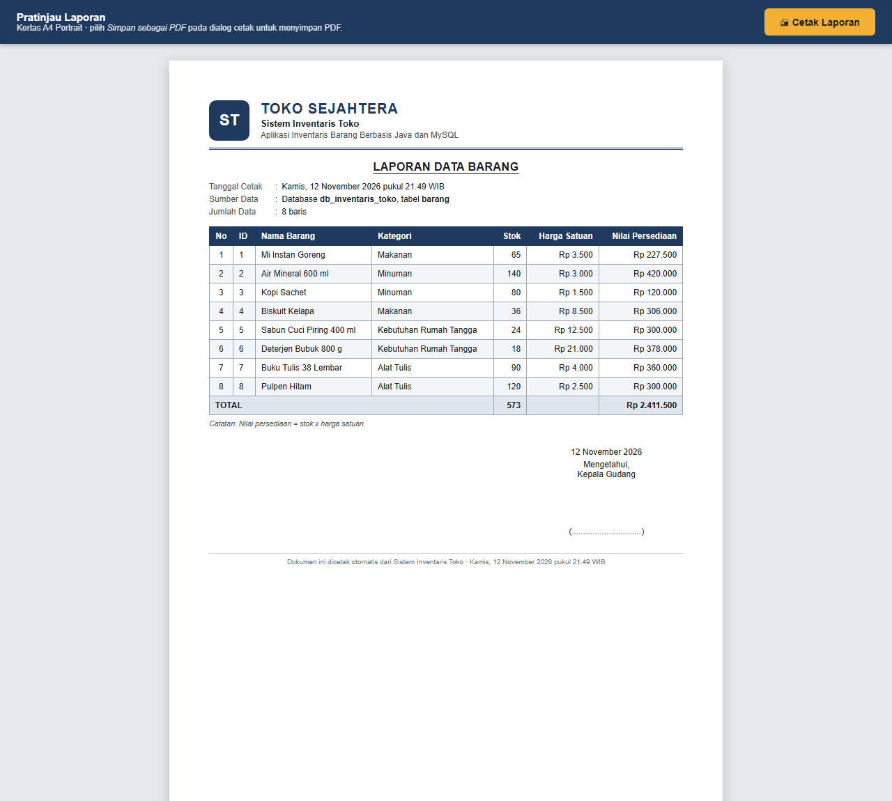
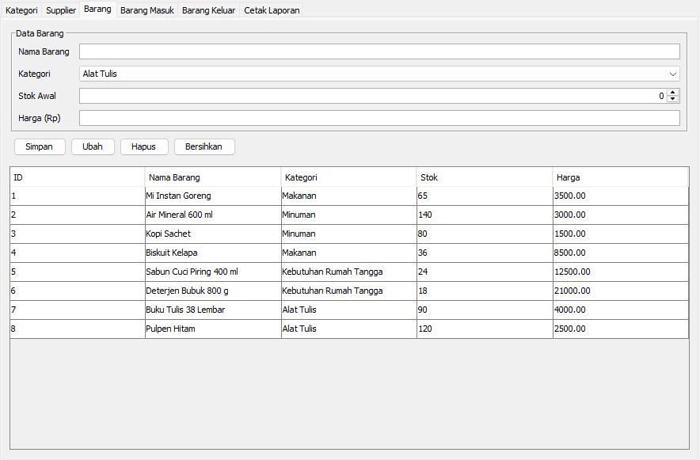
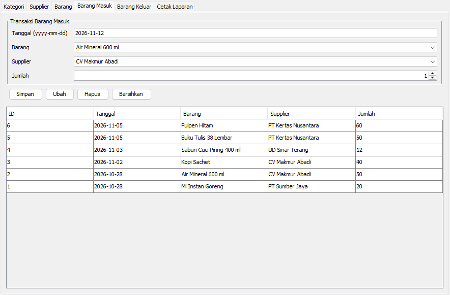
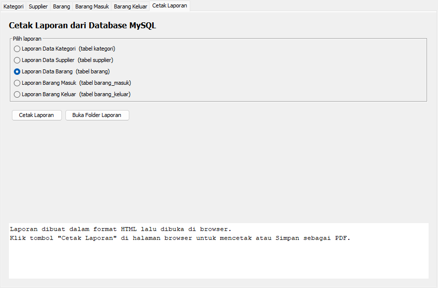
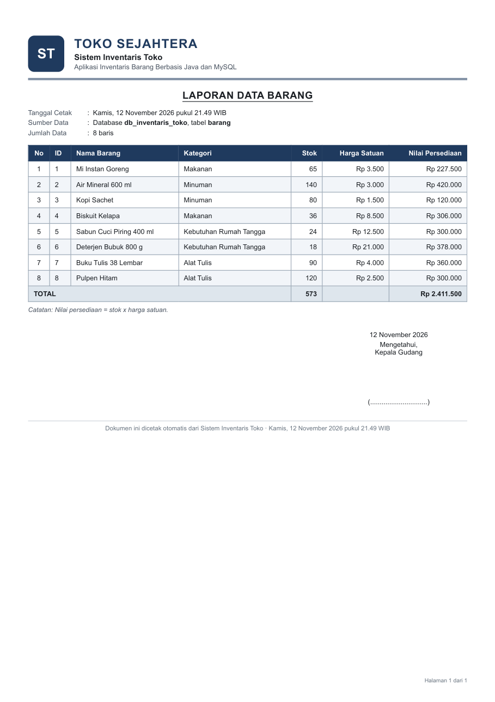
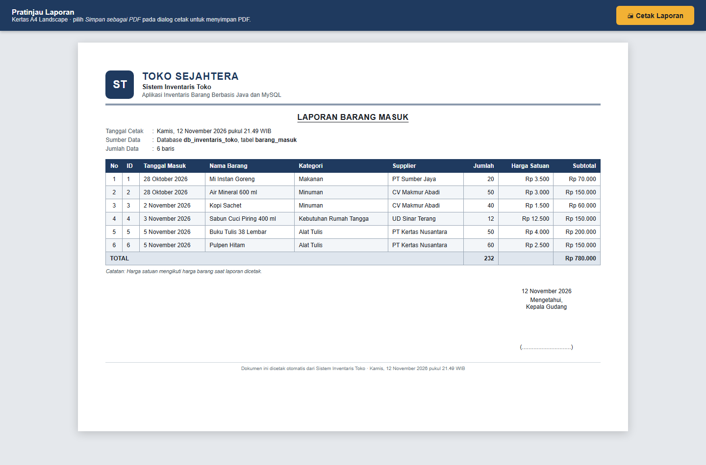
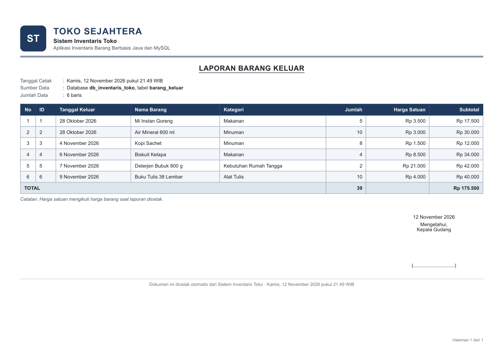
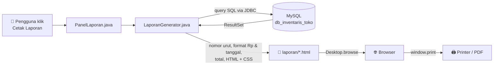
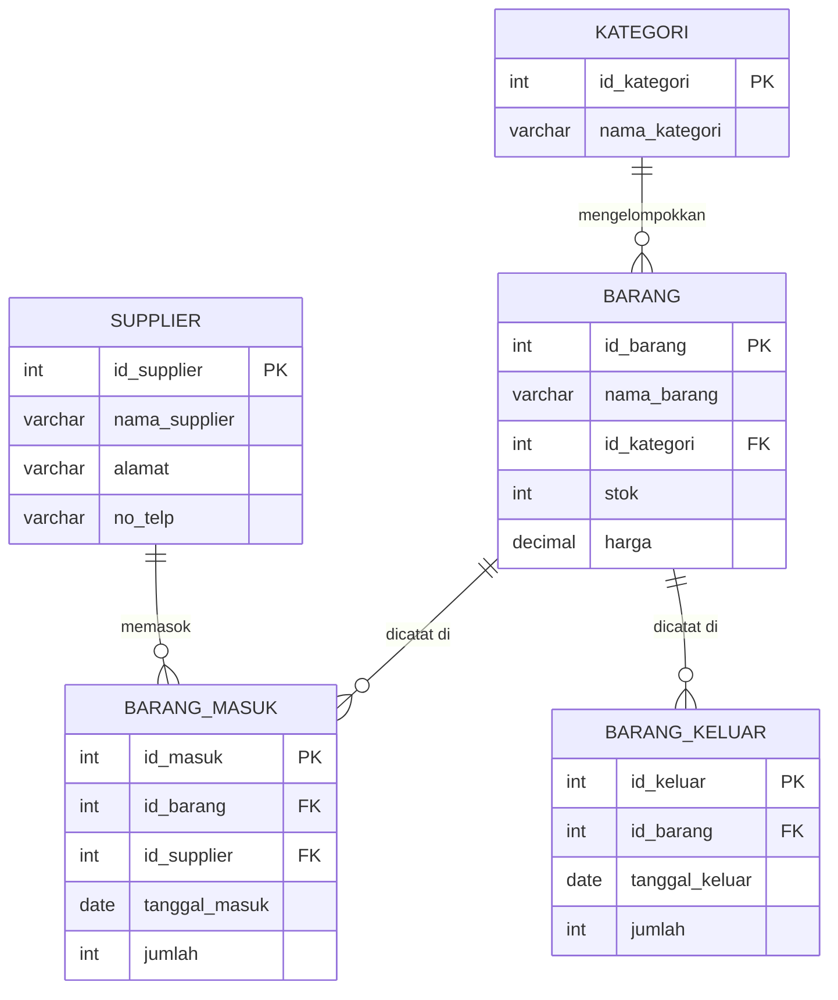

<div align="center">

# 📦 Sistem Inventaris Toko

**Aplikasi desktop Java + MySQL untuk mengelola stok barang, mencatat barang masuk & keluar, dan mencetak laporan siap print / PDF.**


Tugas Mata Kuliah **Pemrograman II**: Pertemuan 11 s.d. 15

[Fitur](#-fitur) •
[Screenshot](#-screenshot) •
[Instalasi](#-instalasi--cara-menjalankan) •
[Cara Pakai](#-cara-pakai) •
[Cetak Laporan](#%EF%B8%8F-cara-kerja-fitur-cetak-laporan) •
[Database](#%EF%B8%8F-struktur-database) •
[Pengujian](#-hasil-pengujian)



</div>

---

## ✨ Fitur

| | Fitur | Keterangan |
|---|---|---|
| 🔌 | **Koneksi JDBC** | Satu class `Koneksi` untuk seluruh aplikasi, jadi pengaturan database cukup di satu tempat |
| 📝 | **CRUD 5 tabel** | Kategori, Supplier, Barang, Barang Masuk, Barang Keluar (tambah, lihat, ubah, hapus) |
| 📈 | **Stok otomatis** | Barang masuk menambah stok, barang keluar mengurangi stok. Ubah/hapus transaksi ikut menyesuaikan stok |
| 🛡️ | **Data aman** | Transaksi database `commit`/`rollback`, stok tidak bisa minus, data yang masih dipakai tidak bisa dihapus (foreign key) |
| 🖨️ | **Cetak Laporan** | Data diambil langsung dari MySQL, disusun menjadi laporan HTML + CSS, lalu dicetak lewat browser |
| 📄 | **Simpan PDF** | Tombol `window.print()` lalu pilih *Simpan sebagai PDF* |
| 📐 | **Layout cetak rapi** | A4 portrait/landscape, margin, header tabel berulang, nomor halaman, tombol tidak ikut tercetak |
| 🇮🇩 | **Format Indonesia** | `Rp 12.500`, `28 Oktober 2026`, `Kamis, 12 November 2026 pukul 21.49 WIB` |

---

## 📸 Screenshot

<table>
  <tr>
    <td align="center"><br><sub><b>Form CRUD Barang</b></sub></td>
    <td align="center"><br><sub><b>Transaksi Barang Masuk</b></sub></td>
  </tr>
  <tr>
    <td align="center"><br><sub><b>Menu Cetak Laporan</b></sub></td>
    <td align="center"><br><sub><b>Hasil Cetak PDF (A4 Portrait)</b></sub></td>
  </tr>
</table>

<details>
<summary><b>Lihat laporan transaksi (A4 Landscape)</b></summary>
<br>


</details>

---

## 🚀 Instalasi & Cara Menjalankan

### Prasyarat

| Kebutuhan | Versi | Catatan |
|---|---|---|
| ☕ **JDK** | 11 atau lebih baru (diuji di JDK 21) | Cek dengan `java -version` |
| 🐬 **MySQL** | 8.x | Paling mudah lewat [Laragon](https://laragon.org) atau [XAMPP](https://www.apachefriends.org) |
| 🌐 **Browser** | Chrome / Edge / Firefox | Untuk menampilkan dan mencetak laporan |

> Driver JDBC (`mysql-connector-j-9.1.0.jar`) **sudah disertakan** di folder `lib/`, jadi tidak perlu unduh lagi.

### Langkah 1: Clone repository

```bash
git clone https://github.com/MaulanaRoyyanTsubaisa/pemrograman2_java-aaaaaaa.git
```

```bash
cd pemrograman2_java-aaaaaaa
```

Atau klik **Code → Download ZIP** lalu ekstrak.

### Langkah 2: Nyalakan MySQL

- **Laragon:** buka Laragon lalu klik **Start All**
- **XAMPP:** buka XAMPP Control Panel lalu klik **Start** pada baris *MySQL*

### Langkah 3: Impor database

Pilih salah satu cara:

<details open>
<summary><b>A. Lewat phpMyAdmin / HeidiSQL (paling mudah)</b></summary>

1. Buka phpMyAdmin (`http://localhost/phpmyadmin`) atau HeidiSQL (Laragon: tombol **Database**).
2. Pilih menu **Import** / **File → Run SQL file**.
3. Pilih file `database/db_inventaris_toko.sql`, lalu jalankan.
4. Database `db_inventaris_toko` beserta 5 tabel dan contoh datanya akan terbentuk.

</details>

<details>
<summary><b>B. Lewat terminal</b></summary>

```bash
mysql -u root < database/db_inventaris_toko.sql
```

</details>

> ⚠️ Script SQL akan **menghapus lalu membuat ulang** database `db_inventaris_toko`. Jangan jalankan ulang jika sudah ada data penting.

### Langkah 4: Sesuaikan koneksi (jika perlu)

Default-nya `root` tanpa password (bawaan Laragon/XAMPP). Jika MySQL kamu memakai password, ubah di
[`src/inventaris/Koneksi.java`](src/inventaris/Koneksi.java):

```java
private static final String USER = "root";
private static final String PASSWORD = "";   // isi password MySQL di sini
```

### Langkah 5: Jalankan aplikasi 🎉

**Windows:** klik dua kali **`run.bat`**

**Linux / macOS:**

```bash
sh run.sh
```

<details>
<summary><b>Manual (tanpa script)</b></summary>

```bash
javac -encoding UTF-8 -d build -cp "lib/*" src/inventaris/*.java src/inventaris/laporan/*.java
```

```bash
java -cp "build;lib/*" inventaris.MenuUtama
```

Di Linux/macOS ganti `;` menjadi `:` pada classpath.

</details>

<details>
<summary><b>Membuka di NetBeans / IntelliJ</b></summary>

- **NetBeans:** *File → New Project → Java with Ant → Java Project with Existing Sources*, pilih folder `src`.
  Lalu klik kanan **Libraries → Add JAR/Folder** dan pilih `lib/mysql-connector-j-9.1.0.jar`. Main class: `inventaris.MenuUtama`.
- **IntelliJ IDEA:** *File → Open* folder proyek, tandai `src` sebagai *Sources Root*,
  lalu *Project Structure → Libraries → +* dan pilih file `.jar` di folder `lib`.

</details>

---

## 📖 Cara Pakai

Aplikasi memiliki 6 tab:

| Tab | Fungsi |
|---|---|
| **Kategori** | Kelola kategori barang (Makanan, Minuman, ...) |
| **Supplier** | Kelola data pemasok: nama, alamat, no. telepon |
| **Barang** | Kelola barang: nama, kategori, stok awal, harga |
| **Barang Masuk** | Catat barang datang dari supplier, **stok bertambah otomatis** |
| **Barang Keluar** | Catat barang terjual/keluar, **stok berkurang otomatis** (ditolak bila stok kurang) |
| **Cetak Laporan** | Pilih laporan, lalu klik **Cetak Laporan** |

### Operasi CRUD

1. **Tambah:** isi form, lalu klik **Simpan**.
2. **Lihat:** data tampil otomatis di tabel bawah (dimuat ulang setiap tab dibuka).
3. **Ubah:** klik baris di tabel (form terisi otomatis), ubah isinya, lalu klik **Ubah**.
4. **Hapus:** klik baris, lalu klik **Hapus** dan konfirmasi.
5. **Bersihkan:** mengosongkan form.

### Mencetak laporan

```
Tab "Cetak Laporan"  →  pilih laporan  →  klik [Cetak Laporan]
        ↓
Browser terbuka menampilkan laporan  →  klik tombol kuning [🖨 Cetak Laporan]
        ↓
Dialog cetak  →  pilih printer  ATAU  "Simpan sebagai PDF"
```

> 💡 **Tips:** pada dialog cetak, buka *Setelan lainnya* lalu **matikan "Header dan footer"** agar alamat file tidak ikut tercetak.
> Pastikan juga **"Grafik latar belakang"** aktif supaya warna header tabel ikut tercetak.

Laporan yang tersedia:

| Laporan | Tabel | Kertas | Isi |
|---|---|---|---|
| Data Kategori | `kategori` | A4 Portrait | Jumlah jenis barang & total stok per kategori |
| Data Supplier | `supplier` | A4 Portrait | Alamat, telepon, jumlah transaksi masuk |
| Data Barang | `barang` | A4 Portrait | Stok, harga, nilai persediaan + total |
| Barang Masuk | `barang_masuk` | A4 Landscape | Tanggal, barang, supplier, jumlah, subtotal + total |
| Barang Keluar | `barang_keluar` | A4 Landscape | Tanggal, barang, jumlah, subtotal + total |

---

## 🖨️ Cara Kerja Fitur Cetak Laporan



**1. Query SQL:** setiap laporan didefinisikan di [`JenisLaporan.java`](src/inventaris/laporan/JenisLaporan.java). Contoh laporan barang:

```sql
SELECT b.id_barang, b.nama_barang, k.nama_kategori, b.stok, b.harga,
       (b.stok * b.harga) AS nilai_persediaan
FROM barang b
JOIN kategori k ON k.id_kategori = b.id_kategori
ORDER BY b.id_barang;
```

**2. Hasil query dibuat menjadi HTML:** [`LaporanGenerator.java`](src/inventaris/laporan/LaporanGenerator.java) membaca `ResultSet` baris per baris, memberi nomor urut, memformat angka/tanggal, menghitung total, lalu menulis file HTML lengkap dengan:

- Kop: logo, nama toko, nama aplikasi
- Judul laporan, tanggal cetak, sumber data, jumlah data
- Tabel data + baris **TOTAL**
- Kolom tanda tangan *"Mengetahui, Kepala Gudang"*

**3. Tombol cetak:**

```html
<div class="toolbar no-print">
    <button type="button" onclick="window.print()">🖨 Cetak Laporan</button>
</div>
```

**4. Pengaturan halaman cetak:**

```css
@page {
    size: A4 portrait;                 /* landscape untuk laporan transaksi */
    margin: 15mm 12mm 18mm 12mm;
    @bottom-right { content: "Halaman " counter(page) " dari " counter(pages); }
}
@media print {
    .no-print { display: none !important; }           /* tombol tidak ikut tercetak */
    * { print-color-adjust: exact; }                   /* warna header tetap tercetak */
    table.data thead { display: table-header-group; }  /* header tabel diulang tiap halaman */
    table.data tr { break-inside: avoid; }             /* baris tidak terpotong */
}
```

> 🎨 Ingin mengganti nama toko di kop laporan? Ubah konstanta `NAMA_INSTANSI`, `NAMA_APLIKASI`, dan `PENANDATANGAN` di bagian atas `LaporanGenerator.java`.

---

## 🗄️ Struktur Database



- Dinormalisasi sampai **3NF**: kategori dan supplier tidak disimpan berulang, cukup dihubungkan dengan foreign key.
- `ON DELETE RESTRICT`: kategori/supplier/barang yang masih dipakai **tidak bisa dihapus**.
- Harga memakai `DECIMAL(12,2)` agar nilai uang tepat.

---

## 📁 Struktur Proyek

```
📦 InventarisToko
├── 📄 run.bat / run.sh            ← jalankan aplikasi
├── 📂 database
│   └── db_inventaris_toko.sql     ← struktur 5 tabel + contoh data
├── 📂 lib
│   └── mysql-connector-j-9.1.0.jar
├── 📂 src/inventaris
│   ├── Koneksi.java               ← koneksi JDBC ke MySQL
│   ├── MenuUtama.java             ← jendela utama (main class)
│   ├── FormDasar.java             ← kerangka form CRUD
│   ├── FormKategori.java          ┐
│   ├── FormSupplier.java          │
│   ├── FormBarang.java            ├ CRUD tiap tabel
│   ├── FormBarangMasuk.java       │
│   ├── FormBarangKeluar.java      ┘
│   ├── Stok.java                  ← transaksi & konsistensi stok
│   ├── PanelLaporan.java          ← tab Cetak Laporan
│   ├── Util.java
│   └── 📂 laporan
│       ├── JenisLaporan.java      ← query SQL tiap laporan
│       ├── Kolom.java             ← definisi kolom laporan
│       └── LaporanGenerator.java  ← HTML + CSS + buka browser
├── 📂 laporan                     ← hasil laporan HTML
└── 📂 dokumentasi
    ├── Dokumentasi Pengujian Cetak Laporan.docx / .pdf
    ├── 📂 pdf                     ← hasil cetak 5 laporan
    └── 📂 screenshot
```

---

## ✅ Hasil Pengujian

<details open>
<summary><b>Koneksi, CRUD & konsistensi stok (13/13 berhasil)</b></summary>

| No | Skenario | Hasil |
|---|---|---|
| 1 | Koneksi Java ke MySQL | ✅ Terhubung ke `db_inventaris_toko` |
| 2–5 | Create/Update kategori, supplier, barang | ✅ Data tersimpan & berubah |
| 6 | Hapus kategori yang masih dipakai barang | ✅ Ditolak (foreign key) |
| 7 | Barang masuk 5 unit | ✅ Stok 10 → 15 |
| 8 | Ubah barang masuk 5 → 8 unit | ✅ Stok 18 |
| 9 | Barang keluar 3 unit | ✅ Stok 15 |
| 10 | Barang keluar 100 unit (melebihi stok) | ✅ Ditolak, stok tetap 15 |
| 11–12 | Hapus transaksi keluar / masuk | ✅ Stok kembali 18 → 10 |
| 13 | Hapus data uji | ✅ Data kembali seperti semula |

</details>

<details open>
<summary><b>Kesesuaian laporan dengan database</b></summary>

| Laporan | Database | Laporan | |
|---|---|---|---|
| Data Barang | 8 data, stok 573, Rp 2.411.500 | 8 data, stok 573, Rp 2.411.500 | ✅ |
| Barang Masuk | 6 data, 232 unit, Rp 780.000 | 6 data, 232 unit, Rp 780.000 | ✅ |
| Barang Keluar | 6 data, 39 unit, Rp 175.500 | 6 data, 39 unit, Rp 175.500 | ✅ |
| Kategori / Supplier | 4 / 4 data | 4 / 4 data | ✅ |

</details>

<details open>
<summary><b>Pencetakan</b></summary>

- ✅ Tombol **Cetak Laporan** memanggil `window.print()`
- ✅ Tombol & toolbar **tidak ikut tercetak**
- ✅ Ukuran kertas A4 portrait (595×842 pt) & landscape (842×595 pt)
- ✅ Warna header tabel ikut tercetak, nomor halaman tampil
- ✅ 5 laporan berhasil disimpan sebagai PDF ([lihat folder `dokumentasi/pdf`](dokumentasi/pdf))

</details>

📘 Dokumentasi lengkap: [**Dokumentasi Pengujian Cetak Laporan.pdf**](dokumentasi/Dokumentasi%20Pengujian%20Cetak%20Laporan.pdf)

---

## 🛠️ Troubleshooting

| Masalah | Solusi |
|---|---|
| `Communications link failure` | MySQL belum menyala. Start MySQL di Laragon/XAMPP |
| `Unknown database 'db_inventaris_toko'` | Database belum diimpor (lihat [Langkah 3](#langkah-3-impor-database)) |
| `Access denied for user 'root'` | Isi `PASSWORD` di `Koneksi.java` sesuai password MySQL kamu |
| `No suitable driver found` | Pastikan file `.jar` ada di folder `lib/` dan ikut di classpath |
| `'javac' is not recognized` | JDK belum terpasang / belum masuk PATH |
| Warna tabel tidak tercetak | Aktifkan **Grafik latar belakang** di dialog cetak |
| Alamat file ikut tercetak | Matikan **Header dan footer** di dialog cetak |

---

<div align="center">

**Pemrograman II** · Dosen Pengampu: **Niki Ratama, M.Kom.**

Dibuat oleh **Maulana Royyan Tsubaisa** · 2026

</div>
